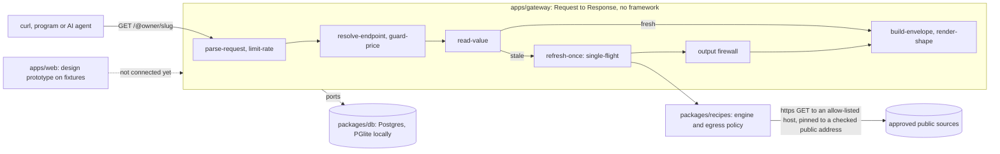

# World API

Real-world data behind one `GET` call, in the shape you ask for: a declarative recipe engine
and a portable data API gateway over live public sources.

[](https://github.com/Brok3nnn/world-api/actions/workflows/ci.yml)
[](LICENSE)
[](https://nodejs.org/)
[](https://pnpm.io/)

## Overview

World API (a working name) answers `GET /@core/topeka-weather` with the latest weather at Topeka
airport, as JSON, a bare number, a sentence or CSV. Each endpoint is backed by a **recipe**, a
declarative document that fetches approved public sources, extracts and computes the value, and
is checked against the endpoint's output spec before anything is stored or returned. No model
runs when a value is served.

- Every endpoint answers in one envelope, `data`, `as_of`, `sources`, `next_refresh`, `method`
  and `price_credits`, and the same value comes as a bare `number`, a `text` sentence or `csv`.
- Six catalog endpoints read five live sources: US and German weather observations, US Treasury
  interest rates, a French address lookup, the latest actively exploited CVE, and a mix that
  compares two of the others.
- Recipes reach only allow-listed public hosts, through an SSRF-hardened egress policy, and only
  fields of the output spec leave the gateway.
- A stale value is refreshed once, however many callers ask at the same time; while a source
  fails, the last value is served for a grace period, then the endpoint answers `503 degraded`.
- Every response credits each source with its name, URL, licence and the attribution its
  licence requires.
- It runs locally in minutes: `pnpm install`, then
  `USER_AGENT_CONTACT=you@example.com pnpm dev:gateway`, which migrates and seeds an in-process
  Postgres on start. No container, account or API key; the contact goes to the sources in the
  User-Agent, as some of them require.

The repository also holds a Next.js **design prototype** of the wider product on typed sample
data; it does not call the API (see [Status and limitations](#status-and-limitations)).

## Getting started

Requires Node.js 24 or newer, pnpm 11 and network access to the public sources.

```bash
git clone https://github.com/Brok3nnn/world-api.git
cd world-api
pnpm install
cp .env.example .env    # then set USER_AGENT_CONTACT, for example you@example.com
pnpm dev:gateway        # http://127.0.0.1:8787, catalog seeded into an in-process Postgres
```

`USER_AGENT_CONTACT=you@example.com pnpm dev:gateway` works without a `.env` file. In a second
terminal (the first call to an endpoint fetches its live source; later calls within its freshness
interval are served from the database):

```bash
curl -s http://127.0.0.1:8787/@core/topeka-weather
curl -s "http://127.0.0.1:8787/@core/treasury-interest-rates?shape=text"
curl -s "http://127.0.0.1:8787/@core/frankfurt-weather?shape=number"
curl -s "http://127.0.0.1:8787/@core/latest-exploited-vulnerability?shape=csv"
curl -s http://127.0.0.1:8787/@core/nanterre-address
curl -s "http://127.0.0.1:8787/@core/weather-difference?shape=text"
curl -s "http://127.0.0.1:8787/search?q=weather"
curl -s -i "http://127.0.0.1:8787/@core/topeka-weather?shape=xml"   # 400 with a hint
```

The first call answers like this (values change with the weather):

```json
{
  "data": {
    "station": "Topeka, Philip Billard Municipal Airport",
    "conditions": "Clear",
    "temperature_c": 9,
    "wind_kmh": 29.6,
    "humidity_percent": 46
  },
  "as_of": "2026-11-22T20:20:00.000Z",
  "sources": [
    {
      "name": "National Weather Service API",
      "url": "https://www.weather.gov/documentation/services-web-api",
      "licence": "Public domain (U.S. Government work)",
      "attribution": null
    }
  ],
  "next_refresh": "2026-11-22T21:22:00.000Z",
  "method": "computed",
  "price_credits": 1
}
```

The other shapes answer plain text: `text` one sentence, such as `Marketable Treasury debt paid
3.57 % on average on 2026-10-31.`, and `csv` a header row in the order of the output spec, then
the values, such as `cve_id,vendor,product,vulnerability,date_added,catalog_entries` for the
vulnerability endpoint. The full contract is in
[docs/architecture/api.md](docs/architecture/api.md).

The sources' terms checks lapse on 2027-02-20 unless the maintainer renews them; after that,
every endpoint answers `503 degraded` and the gateway logs `source.unusable` at start (see
[The 90-day check](#the-90-day-check)).

To look at the web prototype, run `pnpm dev:web` and open http://localhost:3000.

## Architecture



The gateway is one Web-standard `(Request) => Promise<Response>` function built from **ports**:
endpoint directory, value store, refresh lock, recipe runner, rate limiters, usage sink, catalog
search and build queue. Entries choose the adapters: Postgres over PGlite for `pnpm dev:gateway`,
memory adapters and fakes in tests. Pure rules (freshness, shapes, statuses, pricing) live in
`packages/core`; wire formats are Zod schemas in `packages/contracts`. Dependencies point down
only, and lint enforces it. More in [docs/architecture/overview.md](docs/architecture/overview.md).

## How it works

**SSRF-hardened egress policy with DNS pinning.** Every fetch of a recipe passes
[`check-url.ts`](packages/recipes/src/egress/check-url.ts) (`https` on its standard port, no
credentials in the URL, host on the run's allow-list) and
[`resolve-public-addresses.ts`](packages/recipes/src/egress/resolve-public-addresses.ts): every
address the host resolves to must be public, so one private answer refuses the request. The
ranges are in [`ipv4-address.ts`](packages/recipes/src/egress/ipv4-address.ts) and
[`ipv6-address.ts`](packages/recipes/src/egress/ipv6-address.ts): loopback, private, carrier-grade
NAT, link-local with the cloud metadata address, documentation and multicast, and IPv6 blocks
that tunnel to IPv4 such as 6to4 and Teredo. [`node-http-client.ts`](packages/recipes/src/adapters/node-http-client.ts)
then connects to the checked address through a pinned `lookup`, with no connection pooling, so
a second DNS answer cannot redirect it while TLS still verifies the host name. Redirects are
followed at most twice and every hop is checked again; one deadline and a 2 MB streaming size cap
cover the whole fetch ([`create-policed-fetch.ts`](packages/recipes/src/egress/create-policed-fetch.ts)).
A test scans the sources so nothing else calls the network.

**Output firewall.** [`apply-firewall.ts`](packages/recipes/src/firewall/apply-firewall.ts)
walks a small JSON Schema dialect itself, with no dependency or code generation: types,
`required`, `enum`, bounds, `maxLength`, `maxItems`, and `additionalProperties: false`
everywhere. A value that does not match is not stored, returned or priced; violations are JSON
Pointers and rule names, never the offending value, so they are safe to log.

**Framework-free ports-and-adapters gateway.** [`app.ts`](apps/gateway/src/app.ts) builds the
gateway from its ports over a table of four routes, and is the one place that catches defects:
a defect becomes `500 internal_error` with a request id and no detail. The Node server in front
of it answers what the Fetch API cannot represent, such as a `TRACE` request or a malformed
`Host` header, with `400 invalid_request`. Each pipeline stage is one file in
[`pipeline/`](apps/gateway/src/pipeline/) that returns a `Result`.
[`portable-app.test.ts`](apps/gateway/src/portable-app.test.ts) answers every route through
Web-standard `Request` and `Response` objects alone, and lint refuses Node built-ins outside the
entry, configuration and Postgres adapters, so the same code could run on edge isolates.

**One contract suite for memory and Postgres adapters.** Four stateful ports, the endpoint
directory, the value store, the endpoint status store and the catalog search, have a shared suite
in [`ports/testing/`](apps/gateway/src/ports/testing/), such as
[`value-store-contract.ts`](apps/gateway/src/ports/testing/value-store-contract.ts): the memory
adapter and the Postgres adapter, run on a fresh in-process database, both pass it. The refresh
lock, usage sink and build queue test each adapter on its own.

**Freshness, single-flight, grace and degradation as pure rules.** Whether a value is stale, how
`max_age` is clamped to the freshness floor, how long a value stays servable while its source
fails, and when an endpoint moves between `live` and `degraded` are pure functions of an instant
in [`packages/core/src/freshness/`](packages/core/src/freshness/) and
[`status/`](packages/core/src/status/). [`refresh-once.ts`](apps/gateway/src/pipeline/refresh-once.ts)
takes the endpoint's lock, reads again in case another refresh just finished, and runs the recipe
once; concurrent callers wait and read what it stored.

**Sandboxed expression evaluator.** Recipe transforms are JSONata, evaluated by
[`evaluate-expression.ts`](packages/recipes/src/expression/evaluate-expression.ts) with `$now`,
`$millis`, `$random`, `$shuffle` and `$eval` disabled, regular-expression literals refused by
walking the parsed tree, a 250 ms budget checked on every evaluation step through the clock
port, and a depth limit. Patterns run on RE2 (`re2js`) in linear time, so no source text can make
a refresh backtrack without end.

**OpenAPI 3.1 generated from Zod, with a drift check.**
[`openapi-document.ts`](packages/contracts/src/openapi/openapi-document.ts) derives
[`openapi.json`](packages/contracts/openapi.json) from the same schemas the gateway parses with;
`pnpm openapi:check` fails when the committed document no longer matches, and
[`contract.test.ts`](apps/gateway/src/routes/contract.test.ts) checks every route and status
against the schemas.

## Design decisions and trade-offs

The reasoning is recorded in [docs/decisions/](docs/decisions/README.md):

- **Declarative recipes, not generated code** ([0005](docs/decisions/0005-declarative-recipes.md)).
  A recipe can do only what the engine offers, so it is safe to run in the gateway process and
  replayable in tests. Some sources cannot be expressed yet; a sandboxed `code.run` step is planned.
- **A portable gateway with no HTTP framework** ([0003](docs/decisions/0003-staged-hosting.md)).
  Web-standard APIs and ports cost some discipline now and keep a move to edge isolates
  mechanical.
- **Postgres through Drizzle, PGlite for tests and local runs**
  ([0004](docs/decisions/0004-database-and-auth.md)). Tests and `pnpm dev:gateway` need no
  container. PGlite has one connection, so locally the refresh lock is in memory rather than the
  Postgres advisory lock that multi-instance deployments use.
- **JSONata and RE2** ([0012](docs/decisions/0012-recipe-expression-and-pattern-languages.md)).
  Pure, portable and linear-time; recipes give up backreferences and lookaround.
- **TypeScript everywhere, run by Node's type stripping**
  ([0001](docs/decisions/0001-typescript-everywhere.md),
  [0013](docs/decisions/0013-commands-run-typescript-on-node.md)). One toolchain, no build step;
  commands rely on a small resolve hook built on `module.registerHooks`.
- **Core first** ([0007](docs/decisions/0007-core-first-scope.md)). The serving path is built and
  proven; prices are computed and reported, never charged.
- **Demand-driven refresh.** Nothing refreshes without a call: no background jobs or wasted
  fetches, at the cost of one slower call per freshness interval.
- **Strict size limits as lint rules.** Files, functions, complexity and parameters are capped in
  `biome.json`, so units stay small enough to review whole ([docs/conventions.md](docs/conventions.md)).

## Tech stack

| Area | Choice |
| --- | --- |
| Language and runtime | TypeScript 5.9 (strict), Node.js 24 with type stripping |
| Monorepo | pnpm 11 workspaces, explicit `exports` maps, no package build step |
| Contracts | Zod 4; OpenAPI 3.1 generated from the schemas |
| Database | Postgres with Drizzle ORM 0.45 and drizzle-kit migrations; PGlite 0.6 in tests and local runs |
| Recipe engine | JSONata 2.2, re2js 2.10, node-html-parser 9 |
| Web prototype | Next.js 16, React 19, Tailwind CSS 4, Base UI with shadcn/ui, nuqs |
| Quality | Vitest 5 with v8 coverage, Biome 2.4, knip 6, GitHub Actions |

## Configuration

From [`.env.example`](.env.example); copy it to `.env`, which Git ignores. Checks and tests need
no configuration.

| Variable | Required | Default | Purpose |
| --- | --- | --- | --- |
| `USER_AGENT_CONTACT` | For `pnpm dev:gateway`, the proofs and the recorder | None | How a source's operator can reach you: an `https` URL or an email address, sent in the User-Agent `recipe-engine/1 (+<contact>)` of every live fetch. The gateway refuses to start without a valid one |
| `LOG_LEVEL` | No | `info` | Least severe level the gateway writes: `debug`, `info`, `warn` or `error` |

## Testing and quality checks

```bash
pnpm verify   # everything CI runs: check, test, build
pnpm check    # Biome lint and format, tsc, knip, structure, migration and OpenAPI drift checks
pnpm test     # 1,391 tests in 154 files, with coverage floors per workspace
pnpm build    # production build of the web prototype
```

No test touches the network, the system clock or real randomness: sources are replayed from
recorded responses, HTTP adapters are tested against loopback servers, and every database test
gets a fresh in-process Postgres. Coverage of this version (floors are enforced by `pnpm test`):

| Workspace | Lines | Branches | Floor |
| --- | --- | --- | --- |
| `packages/contracts` | 100 % | 100 % | 95 % |
| `packages/core` | 100 % | 100 % | 95 % |
| `packages/recipes` | 99.6 % | 96.9 % | 95 % |
| `packages/db` | 98.7 % | 95.8 % | 90 % |
| `apps/gateway` | 99.0 % | 95.0 % | 90 % |

The web prototype has no tests. `pnpm proof:recipe` and `pnpm proof:gateway` run the engine and
the gateway against the live sources and write a report to [docs/proofs/](docs/proofs/README.md).
More in [docs/testing.md](docs/testing.md).

## Project structure

```
world-api/
├── .github/          CI workflow, Dependabot, issue and pull request templates
├── apps/
│   ├── gateway/      The data API: routes, pipeline stages, ports, adapters, Node entry
│   └── web/          Next.js design prototype on typed sample data
├── packages/
│   ├── contracts/    Zod contracts and the generated OpenAPI 3.1 document
│   ├── core/         Pure rules: freshness, shapes, statuses, pricing, ids
│   ├── db/           Drizzle schema, eight migrations, query modules, seed
│   └── recipes/      Recipe engine, egress policy, output firewall, expression sandbox
├── docs/
│   ├── architecture/ System design, one document per area
│   ├── decisions/    Architecture decision records
│   └── proofs/       Reports of runs against live sources
└── scripts/          Structure, migration and OpenAPI checks; the TypeScript resolve hook
```

## Status and limitations

**Works.** The recipe engine and the gateway work locally against live public sources:
`pnpm dev:gateway` serves the six catalog endpoints in every shape their output spec allows,
with search, single-flight refresh, grace periods and degradation, on the real Postgres adapters.

**Does not.** The web app is a prototype on sample data. Its endpoints, statistics, publishers
and credit balances are fictional, sign-in is simulated in the browser, API keys are random
strings, and it never calls the gateway. A notice on every page says so.

**Planned, not built.** The builder agent that turns a natural-language request into a new,
tested endpoint ([design](docs/architecture/builder.md)); publishing one's own data; accounts and
API keys; metering and payments. Prices are reported in `price_credits` but nothing is charged,
and `/builds/{id}` answers `404` because nothing creates builds yet.

Other limits worth knowing:

- Local values live as long as the process: the in-process database is migrated and seeded on
  every start, and one process holds the refresh lock and rate limits in memory.
- The source terms were checked on 2026-11-22. A check older than 90 days makes a source unusable
  (see [The 90-day check](#the-90-day-check)), so from 2027-02-20 every endpoint answers
  `503 degraded` until the checks are renewed.
- Recipes depend on each source's format; the Frankfurt endpoint reads a CSV with German column
  labels. A format change degrades that one endpoint until its recipe is updated.

## Roadmap

All of the following is **Planned**:

- The builder agent: interpret a request, pick approved sources, draft and test a recipe, publish
  a private endpoint, and repair recipes whose source changed.
- Accounts, hashed API keys and per-key limits; then metering and billing.
- Publishing one's own data (push, pull, file, existing API) with server-enforced output rules.
- One MCP server with `search` and `get` tools for AI agents.
- The web app on the real system, and a hosted deployment with a path to edge isolates.

## Data sources and attribution

Every source is recorded in the registry ([`packages/db/src/seed/sources/`](packages/db/src/seed/sources/))
with its licence, the attribution it requires, the terms read on its own pages and the date of
that check. Responses carry each source's name, URL, licence and required attribution in
`sources`.

| Source | Used by | Licence | Conditions recorded in the registry | Attribution returned |
| --- | --- | --- | --- | --- |
| api.weather.gov, National Weather Service API | `topeka-weather`, `weather-difference` | Public domain (U.S. Government work) | A User-Agent identifying the app with contact details is required; reasonable-use rate limits; do not imply NWS endorsement or present altered data as official | None required |
| opendata.dwd.de, Deutscher Wetterdienst Open Data Server | `frankfurt-weather`, `weather-difference` | CC BY 4.0 | Attribution; altered data must be marked as altered; altered official warnings must not carry DWD source details | "Based on data from Deutscher Wetterdienst, values extracted and processed" |
| api.fiscaldata.treasury.gov, U.S. Treasury Fiscal Data API | `treasury-interest-rates` | Unrestricted (U.S. Treasury open data) | Free and without restriction for commercial and non-commercial use | None required |
| data.geopf.fr, Géoplateforme geocoding (IGN), Base Adresse Nationale | `nanterre-address` | Licence Ouverte 2.0 | Commercial reuse allowed; at most 50 requests per second per IP; the credit names the source and the date of the data | "Source: Base Adresse Nationale (BAN) via IGN Géoplateforme"; show it with `as_of`, as the answer carries no update date of its own |
| www.cisa.gov, CISA Known Exploited Vulnerabilities Catalog | `latest-exploited-vulnerability` | CC0 1.0 | No use of the CISA logo or DHS seal and no implied endorsement; third-party links inside entries keep their own terms | None required |
| luftdaten.umweltbundesamt.de, Umweltbundesamt Air Data API v4 | Registered, not used yet: its API answers only for dates named in the URL | dl-de/by-2-0 | Commercial use allowed; changes must be marked in the credit; current-year values are unaudited | "Source: German Environment Agency (Umweltbundesamt) with data from the federal and state monitoring networks; dl-de/by-2-0 (https://www.govdata.de/dl-de/by-2-0)" |

This project is not endorsed by any of these providers. The recorded responses used as test
fixtures (`packages/recipes/src/golden/recordings/`, `apps/gateway/src/catalog/recordings/`) are
copies of their data under the same terms, listed in [docs/assets.md](docs/assets.md); the
vulnerability catalog recording keeps only its first 25 rows.

### The 90-day check

The maintainer re-reads the terms of every source at least every 90 days and commits the date of
the check; the checks of this version were made on 2026-11-22 and lapse on 2027-02-20. A source
may be read only while it is `green` and its `policy_checked_at` is less than 90 days old
([`usable-source.ts`](packages/core/src/sources/usable-source.ts)): an older check removes its
hosts from every run's allow-list, `pnpm dev:gateway` logs a `source.unusable` warning at start,
and its endpoints answer `503 degraded` with a hint that retrying does not help.

To run an older checkout, renew the checks locally: re-read the terms at each source's
`evidence_url`, update `terms`, `licence` and `attribution` in its file under
`packages/db/src/seed/sources/` if they changed, set `policy_checked_at` to the date of your
check, and restart the gateway, which seeds its database again. Tests run at fixed instants and
are not affected by the expiry.

## Licence

Copyright (C) 2026 Balint Vitan.

This program is free software: you can redistribute it and/or modify it under the terms of the
GNU Affero General Public License as published by the Free Software Foundation, version 3 only
(`AGPL-3.0-only`). It is distributed without any warranty; see [LICENSE](LICENSE) for the full
text. If you run a modified version as a network service, the licence requires you to offer its
source to its users.

Data from the sources above stays under its own terms. The cover photos of the web prototype are
under the Unsplash License, and its interface components keep the MIT notice of shadcn/ui
([docs/assets.md](docs/assets.md)).

## About

Built by [Balint Vitan](https://github.com/Brok3nnn), with AI-assisted tooling.
